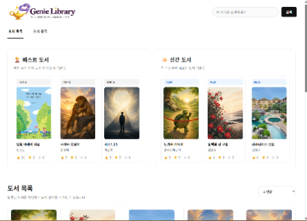
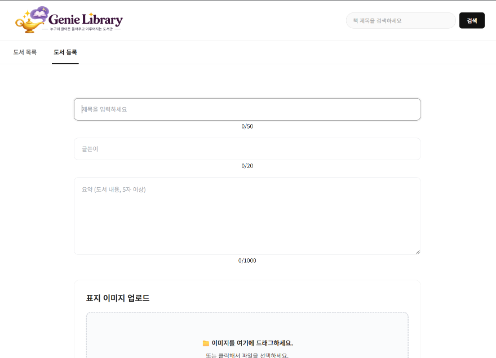
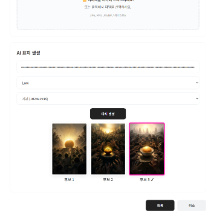
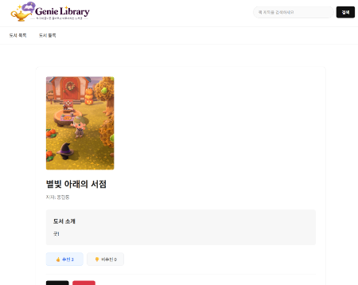
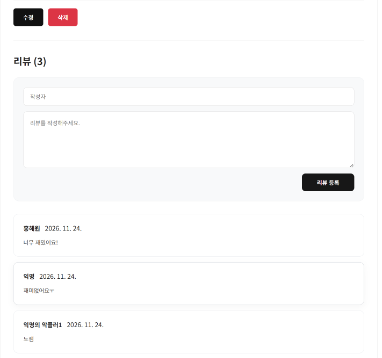
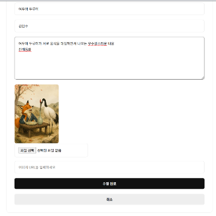

<p align="center">
  
</p>

<h3 align="center">누구의 글이든 들어주고 이루어지는 도서관</h3>
<p align="center">AI 도서 표지 생성과 사용자 추천 기반 도서 관리 서비스</p>

---

## 📌 1. 프로젝트 소개

**Genie Library**는 React와 JSON Server를 활용한 웹 기반 도서 관리 서비스입니다.

사용자는 도서 제목, 저자, 줄거리를 입력하고 AI가 생성한 **표지 후보 3개** 중 원하는 이미지를 선택하여 도서를 등록할 수 있습니다. 도서 검색과 CRUD 기능은 물론, 추천·비추천, 인기 도서 TOP 3 및 신간 도서 TOP 3를 제공합니다.

| 구분 | 내용 |
|---|---|
| 프로젝트명 | Genie Library |
| 프로젝트 | KT AIVLE School Mini Project 4 |
| 개발 형태 | 6인 팀 프로젝트 |
| 개발 환경 | React, Vite |
| 데이터 관리 | JSON Server, `db.json` |
| 주요 특징 | AI 표지 생성, 추천 기반 인기 도서 선정 |

---

## ✨ 2. 주요 기능

### 🎨 2.1 AI 도서 표지 생성

- 표지 이미지 직접 업로드 (JPG, PNG, WebP / 최대 5MB)
- OpenAI Image Generation API 활용
- 사용 모델: **GPT Image 2 (`gpt-image-2`)**
- 도서 제목·저자·줄거리 기반 프롬프트 구성
- AI 표지 후보 **3개** 생성 및 미리보기
- 이미지 품질 선택: Low / Medium / High
- 이미지 크기 선택: 기본(1024×1536) / 작게(768×1152)
- 원하는 AI 표지 또는 업로드한 이미지로 도서 등록

### 📚 2.2 도서 관리 (CRUD)

| 기능 | 설명 |
|---|---|
| Create | 제목, 저자, 내용, 표지 이미지 등록 |
| Read | 전체 도서 목록 및 상세 정보 조회 |
| Update | 기존 도서 정보 수정 |
| Delete | 등록된 도서 삭제 |

### 🔎 2.3 도서 검색

- 도서 제목 기준 검색
- 검색 결과에 해당하는 도서 목록 표시
- 검색 결과 수 및 결과 없음 안내

### 👍 2.4 추천·비추천

- 도서 상세 페이지에서 추천 또는 비추천
- JSON Server에 추천·비추천 수 저장
- 홈 화면 도서 카드 및 상세 화면에 집계 표시

### 🏆 2.5 베스트 도서 TOP 3

- **추천 수** 기준 내림차순 정렬
- 상위 3권에 TOP 1 / TOP 2 / TOP 3 표시

> 현재 베스트 도서 선정 기준은 추천 수입니다. 비추천 수를 차감하는 점수 방식은 적용하지 않았습니다.

### ✨ 2.6 신간 도서 TOP 3

- 등록일(`createdAt`) 기준 최신순 정렬
- 최근 등록된 도서 3권에 `NEW` 표시

---

## 🛠️ 3. 기술 스택

| 구분 | 사용 기술 | 역할 |
|---|---|---|
| Frontend | React, JavaScript | 화면 및 기능 구현 |
| Build Tool | Vite | 개발 서버 및 빌드 |
| Routing | React Router | 페이지 이동 및 URL 관리 |
| Styling | CSS | 화면 디자인 |
| API 통신 | Fetch API | 서버 요청 및 응답 처리 |
| Backend | JSON Server 0.17.4 | REST API 제공 |
| Data Storage | `db.json` | 도서 데이터 저장 |
| AI | OpenAI Image Generation API (GPT Image 2) | 도서 표지 생성 |
| Version Control | Git, GitHub | 협업 및 버전 관리 |
| UI Design | Figma | 화면 설계 |

---

## 📂 4. 프로젝트 폴더 구조

```text
Library_Mini4/
├── README.md
├── .gitignore
└── library_mini4/
    ├── components/
    │   ├── Header.jsx
    │   ├── Navigation.jsx
    │   ├── BookItem.jsx
    │   ├── BookList.jsx
    │   ├── BookReview.jsx
    │   ├── review.jsx
    │   ├── books.jsx
    │   └── Genie_Library_Logo.png
    ├── src/
    │   ├── assets/
    │   ├── main.jsx
    │   ├── App.jsx
    │   ├── App.css
    │   ├── index.css
    │   ├── Home.jsx
    │   ├── BookForm.jsx
    │   ├── BookForm.css
    │   ├── BookContent.jsx
    │   ├── BookContent.css
    │   ├── BookEdit.jsx
    │   └── BookEdit.css
    ├── public/
    │   ├── favicon.svg
    │   ├── icons.svg
    │   └── screenshots/
    │       ├── Home.png
    │       ├── List.png
    │       ├── Select.png
    │       ├── Create.png
    │       ├── Detail.png
    │       ├── Review.png
    │       └── Edit.png
    ├── db.json
    ├── package.json
    ├── package-lock.json
    ├── index.html
    ├── vite.config.js
    └── eslint.config.js
```

| 파일 | 역할 |
|---|---|
| `App.jsx` | 페이지 라우팅 및 공통 화면 |
| `Home.jsx` | 베스트·신간·전체 도서 목록 |
| `BookForm.jsx` | 도서 등록 및 AI 표지 생성 |
| `BookContent.jsx` | 상세 조회 및 추천·비추천 |
| `BookEdit.jsx` | 도서 정보 수정 화면 |
| `Header.jsx` | 로고 및 검색창 |
| `Navigation.jsx` | 메뉴 이동 |
| `books.jsx` | 도서 API 요청 함수 |
| `BookReview.jsx`, `review.jsx` | 리뷰 관련 코드 (동작 여부 별도 확인 필요) |
| `db.json` | 도서 데이터 저장 |

---

## 🚀 5. 프로젝트 실행 방법

### ① 저장소 복제

```bash
git clone https://github.com/Positive-Lee/Library_Mini4.git
```

### ② 프로젝트 폴더 이동

```bash
cd Library_Mini4/library_mini4
```

### ③ 패키지 설치

```bash
npm install
```

기존 README의 ④ JSON Server 실행 부분을 아래 내용으로 바꾸자.
### ④ JSON Server 실행 (0.17.4 버전)

본 프로젝트는 **JSON Server 0.17.4 버전**을 사용합니다.

최신 버전에서는 AI 표지 이미지 저장 시
`Payload too large` 오류가 발생할 수 있으므로
0.17.4 버전으로 실행하는 것을 권장합니다.

첫 번째 터미널에서 다음 명령어를 실행합니다.

```bash
npx json-server@0.17.4 --watch db.json --port 3000
```

**JSON Server 주소**

- http://localhost:3000
- http://localhost:3000/books

> `db.json`이 있는 `library_mini4` 폴더에서 실행해야 합니다.

### ⑤ React 개발 서버 실행

두 번째 터미널에서 실행합니다.

```bash
npm run dev
```

**React 접속 주소:** http://localhost:5173/

브라우저에서 터미널에 표시된 주소로 접속합니다. 기본 주소는 http://localhost:5173/ 이며, 해당 포트가 사용 중이면 다른 포트로 실행될 수 있습니다.

---

## 🔗 6. REST API 명세

### 6.1 도서 관리 API

**Base URL:** `http://localhost:3000`

| 기능 | Method | Endpoint |
|---|---|---|
| 전체 도서 조회 | GET | `/books` |
| 도서 상세 조회 | GET | `/books/:id` |
| 제목 검색 | GET | `/books?title_like=검색어` |
| 도서 등록 | POST | `/books` |
| 도서 수정 | PATCH | `/books/:id` |
| 도서 삭제 | DELETE | `/books/:id` |
| 추천·비추천 갱신 | PATCH | `/books/:id` |

### 6.2 OpenAI 이미지 생성 API

| 항목 | 내용 |
|---|---|
| API | OpenAI Image Generation API |
| 사용 모델 | GPT Image 2 (`gpt-image-2`) |
| Method | POST |
| Endpoint | `https://api.openai.com/v1/images/generations` |
| 기능 | 도서 제목·저자·줄거리를 기반으로 표지 이미지 3개 생성 |
| 이미지 품질 | Low / Medium / High |
| 이미지 크기 선택 | 기본(1024×1536) / 작게(768×1152) |
| 이미지 형식 | WebP |

> 이미지 크기는 현재 화면의 선택 옵션 기준이며, 각 크기의 실제 API 생성 성공 여부는 별도 확인이 필요합니다.

### 6.3 도서 데이터 구조 예시

```json
{
  "id": "1",
  "title": "별빛 아래의 서점",
  "author": "홍길동",
  "content": "도서 소개 내용",
  "coverImageUrl": "이미지 URL 또는 데이터 URL",
  "recommend": 0,
  "notRecommend": 0,
  "createdAt": "2026-11-20T09:00:00.000Z",
  "updatedAt": "2026-11-20T09:00:00.000Z"
}
```

| 필드 | 설명 |
|---|---|
| `id` | 도서 고유 ID |
| `title` | 도서 제목 |
| `author` | 저자 |
| `content` | 도서 내용 및 소개 |
| `coverImageUrl` | 표지 이미지 주소 또는 데이터 |
| `recommend` | 추천 수 |
| `notRecommend` | 비추천 수 |
| `createdAt` | 등록 일시 |
| `updatedAt` | 수정 일시 |

---

## 🖥️ 7. 주요 페이지

### 7.1 주요 페이지 구성

| 페이지 | URL | 주요 기능 |
|---|---|---|
| 홈 | `/` | 베스트·신간·전체 도서 목록, 도서 검색 및 정렬 |
| 도서 등록 | `/books/new` | 도서 정보 입력, 이미지 업로드 및 AI 표지 생성 |
| 도서 상세 | `/books/:id` | 상세 조회, 추천·비추천 및 리뷰 |
| 도서 수정 | `/books/:id/edit` | 도서 정보 수정 |

### 7.2 주요 화면 및 스크린샷

#### 🏠 홈 화면

- Genie Library 로고 및 검색창
- 베스트 도서 TOP 3와 신간 도서 TOP 3
- 전체 도서 목록 및 도서별 추천·비추천·리뷰 수
- 최신순·오래된순·추천순·리뷰순·가나다순 정렬



#### 🎨 도서 등록 화면

- 제목·저자·줄거리 입력
- 표지 이미지 직접 업로드 지원
- AI 이미지 생성 품질 및 크기 선택



#### ✨ AI 표지 생성 및 선택

- GPT Image 2를 활용한 표지 후보 3개 생성
- 생성된 표지 미리보기 및 원하는 이미지 선택
- 선택한 표지로 도서 등록



#### 📖 도서 상세 화면

- 도서 표지 및 상세 정보 확인
- 추천·비추천 기능
- 도서 수정 및 삭제 기능



#### 💬 도서 리뷰

- 도서별 리뷰 작성 및 조회
- 등록된 리뷰 목록과 작성 내용 확인
- 홈 화면에서 도서별 리뷰 개수 표시



#### ✏️ 도서 수정 화면

- 기존 도서 정보 확인 및 수정
- 수정한 도서 정보 저장



---

## 🌟 8. 프로젝트 특징

### AI를 활용한 도서 표지 제작

책의 제목과 줄거리에 어울리는 AI 이미지를 생성하여 사용자가 자신의 이야기를 시각적으로 표현할 수 있도록 합니다.

### 사용자 참여형 도서 평가

추천·비추천 데이터를 기록하고 도서 카드와 상세 화면에 표시합니다.

### 추천 기반 베스트 도서 선정

추천 수가 높은 상위 3권을 선정하여 인기 도서를 쉽게 확인할 수 있도록 구성했습니다.

### 신간 도서 제공

최근 등록된 책을 별도로 표시하여 새로운 도서를 쉽게 찾을 수 있도록 합니다.

---

## 🔐 9. API 키 및 보안

AI 표지 생성에는 OpenAI Image Generation API를 사용합니다.

- 사용자가 본인의 OpenAI API 키를 직접 입력하여 AI 표지를 생성합니다.
- API 키는 GitHub 저장소에 포함하지 않습니다.
- 서비스 운영자가 사용자의 API 키를 별도로 수집하거나 저장하지 않는 방식을 지향합니다.

---

## 🔮 10. 향후 개선 사항

### 👤 사용자 계정 및 권한 관리
- 회원가입·로그인 기능 도입
- 사용자별 추천·비추천 중복 참여 방지
- 리뷰 작성자 본인만 수정·삭제할 수 있도록 권한 관리

### 💬 리뷰 기능 확장
- 리뷰에 대한 답글(대댓글) 작성 기능
- 본인이 작성한 리뷰 및 답글 수정·삭제
- 리뷰별 좋아요 기능 검토

### 🏆 도서 순위 및 추천 시스템 개선

- 추천과 비추천에 가중치를 적용한 도서 점수 산정 및 베스트 도서 TOP 3 순위 개선
- 사용자별 추천·비추천 중복 참여 방지
- 추천·비추천 버튼 클릭 시 애니메이션 효과 추가

---

<p align="center"><b>Genie Library | KT AIVLE School Mini Project 4</b></p>
<p align="center">누구의 글이든 들어주고 이루어지는 도서관</p>
